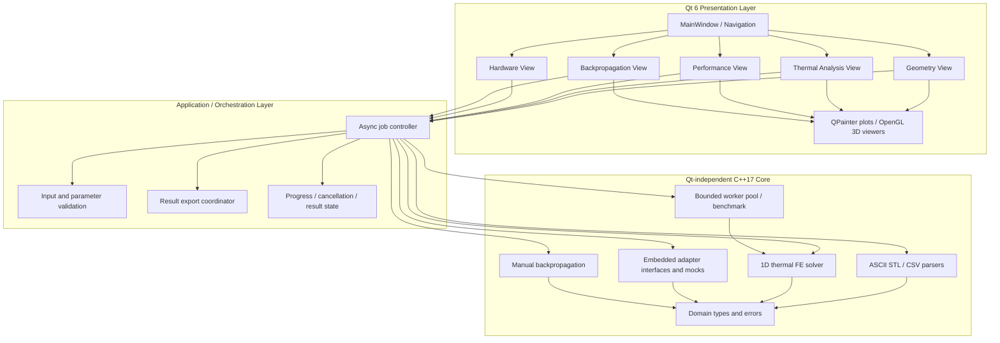

# Architecture specification

## 1. Chosen application shape

A **native Windows desktop application** is the recommended default. Use Qt 6 Widgets for the UI and OpenGL widgets for 3D rendering. Put the computational and file-processing logic in a plain C++17 library with no Qt dependency.

This choice is deliberate: a local web server plus browser/WebView adds a second process and runtime packaging surface. A native Qt desktop app provides a more direct path to a single `Launch.exe` package while preserving a clear boundary between the reusable C++ core and UI.

## 2. Layered architecture



## 3. Source module responsibilities

### `src/core/include/workbench/` and `src/core/src/`

- `domain/`: `Point3D`, `Triangle`, `MeshData`, `TemperatureNode`, `TemperatureField`, `ThermalProblem`, `ThermalSolution`, `BenchmarkCase`, `BenchmarkSummary`, `DeviceDescriptor`, `TelemetryMessage`, and error/result types.
- `io/`: ASCII STL parser and CSV parser/writer. No Qt file or widget types.
- `thermal/`: 1D linear-element assembly, Dirichlet reduction, tridiagonal solve, FE interpolation, analytical reference and error calculations.
- `performance/`: seeded case generation, bounded worker pool, serial runner, parallel runner, timing and raw measurement structures.
- `embedded/`: adapter contract, three mock adapters, deterministic timeout injection and recovery.
- `backprop/`: tanh regression forward pass, hand-coded gradients, update, finite difference and loss history.
- `common/`: validation, cancellation token, status/error model and unit helpers.

### `src/app/`

- Qt `QMainWindow` navigation and panels.
- Thin input forms and result tables.
- `QOpenGLWidget` triangle and point-cloud views. Rendering receives validated domain data; it never parses the files.
- `QPainter` or a similarly small Qt plotting layer for 2D temperature/convergence, benchmark and loss plots.
- Async orchestration that invokes core operations off the GUI thread and marshals progress/results back to the UI thread.
- UI state and formatting. No solver equations or parsing implementation here.

## 4. Core API style

Prefer explicit request/result structures over long positional parameter lists. Example conceptual APIs:

```cpp
ParseResult<MeshData> parseAsciiStl(const std::filesystem::path&, const ParseLimits&);
ParseResult<TemperatureField> parseTemperatureCsv(const std::filesystem::path&, const ParseLimits&);
ThermalSolution solveThermal1D(const ThermalProblem&, const CancellationToken&);
BatchResult runSerial(const std::vector<BenchmarkCase>&, const BatchConfig&);
BatchResult runParallel(const std::vector<BenchmarkCase>&, const BatchConfig&, unsigned workers);
BackpropResult trainOneSample(const BackpropConfig&);
```

These are interface examples, not mandatory final signatures. Errors should carry a stable code, user-facing message and diagnostic context. Never silently replace invalid input with a default.

## 5. Threading and cancellation

- GUI thread: event handling and drawing only.
- One app-level background task per user operation; use Qt's thread support for job orchestration if useful.
- Core batch execution: a bounded pool of `std::thread` workers, with the worker count capped by the request and available logical CPUs.
- Core parallelism is distinct from the UI's asynchronous thread.
- Use shared cancellation state (`std::atomic_bool` or a small cancellation token) checked between cases and at safe solver checkpoints.
- Build results in local temporary storage. Publish a complete result only on success. A cancelled operation discards the partial result and leaves the last completed result intact.
- Do not create unbounded threads per case. Avoid nested parallelism.

## 6. Error and status model

Statuses: `Idle`, `Validating`, `Running`, `Cancelling`, `Completed`, `Cancelled`, `Failed`.

Errors should tell users what field/file failed and how to fix it. Examples:
- `STL_UNSUPPORTED_BINARY`: “This viewer accepts ASCII STL only. Export the mesh as ASCII STL.”
- `CSV_MISSING_COLUMN`: identify the missing required header.
- `CSV_NON_FINITE_VALUE`: identify row and column containing NaN/Inf.
- `THERMAL_INVALID_K`: “Thermal conductivity k must be finite and greater than zero.”
- `JOB_CANCELLED`: report cancellation without presenting partial output as a completed result.
- `DEVICE_TIMEOUT_SIMULATED`: clearly say the mock adapter timed out and offer retry/reconnect.

## 7. File and result ownership

- Input files are read-only; never overwrite an imported source.
- Result exports are written to a user-selected location using a temporary file followed by an atomic rename where supported.
- Use relative paths from the executable or explicit user-selected paths. No absolute developer paths.
- Keep raw CSV results separate from rendered plots and summary reports.
- Add provenance metadata for generated example data and benchmarks.

## 8. Proposed dependency and build boundaries

- C++17 standard library for core containers, algorithms, filesystem, threading and timing.
- CMake for configuration and build.
- Qt 6 Widgets and Qt OpenGLWidgets for the desktop presentation.
- A small unit test framework (Catch2 v3 or GoogleTest) selected and pinned during setup; no test framework dependency in the release app.
- Avoid separate numerical, CSV, STL, plotting or 3D engine libraries unless implementation evidence demonstrates they materially reduce risk. Any added dependency needs a version, licence, rationale and package plan.

Exact dependency versions, compiler flags and licence details must be recorded in `docs/MODEL_AND_TECH_DECISIONS.md` and the dependency lock/manifest created by implementation.
