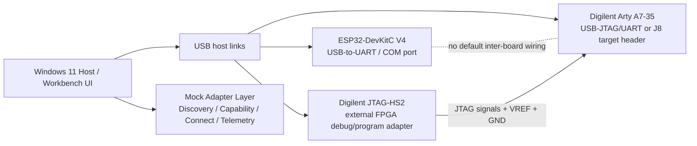

# Task E — embedded-system design and mock adapters

## 1. Scope and safety boundary

The required prototype is a **design plus C++ mock adapters**. Physical wiring, PCB fabrication, firmware deployment, and real FPGA programming are not required. The UI must label every device and event as `SIMULATED`.

Reference design choices used for the documentation:
- Microcontroller development board: **Espressif ESP32-DevKitC V4 with ESP32-WROOM-32E**.
- FPGA development board: **Digilent Arty A7-35** (verify the exact board variant/revision before using real hardware).
- External JTAG debug/programming adapter: **Digilent JTAG-HS2**.

These choices establish a concrete example for the pin/voltage discussion; they do not imply that the candidate owns the boards or has wired them.

## 2. Modular host-connected block diagram



For the software prototype, the Mock Adapter Layer represents all devices. If physical hardware were ever connected, the host communication path and electrical connections would be implemented as separate transport adapters.

## 3. Board/interface assumptions

| Item | ESP32-DevKitC V4 (WROOM-32E) | Arty A7-35 | JTAG-HS2 |
|---|---|---|---|
| Role | Microcontroller board | FPGA development board | Debug/programming adapter |
| Host connection | Micro-USB to USB-to-UART bridge; enumerates as serial/COM with appropriate driver | Micro-AB USB J10 provides onboard USB-JTAG/UART | USB 2.0 to host; target connector to Arty A7 J8 |
| Board input power | Micro-USB 5V by default; board also has 5V/GND or 3V3/GND header options, but Espressif says use exactly one supply option at a time | USB 5V at J10 or separate 7–15V DC input at J13 (follow the specific manual) | USB powered; JTAG I/O voltage is referenced from target VREF |
| Logic/interface voltage | 3.3V GPIO supply/reference; treat GPIO as 3.3V logic, not 5V tolerant | Pmod I/O commonly uses LVCMOS 3.3V; FPGA banks/rails are not interchangeable | Target-referenced signal buffers; product documentation states 1.8–5V signal voltage capability and requires VREF tied to the target JTAG I/O supply |
| Ground | Board GND | Board GND | Target GND must be common with adapter/target reference as specified by manufacturer |
| Connector assumption | Micro-USB and 2x19 pin headers; exact module version matters | J10 USB port, J8 6-pin external JTAG header, JA–JD Pmod headers | Cable/connector must match J8 and orientation; verify pin 1 and cable wiring from current HS2 documentation |
| Firmware / programming | UART bootloader through USB-to-UART; JTAG pins may be multiplexed on ESP32 GPIOs | FPGA bitstream configuration via onboard USB-JTAG or external adapter | JTAG TAP access; not a generic compute board |

## 4. Signal-level table

| Signal / interface | Direction (host/device perspective) | Expected domain / rule | Ownership / caution |
|---|---|---|---|
| ESP32 USB D+/D− | Host ↔ USB-UART bridge | USB interface; board supplies/regulates its own logic rails | Host enumerates serial bridge; this is not direct GPIO wiring |
| ESP32 UART TX/RX (example GPIO1/GPIO3 via bridge) | Board TX → host RX; host TX → board RX | 3.3V logic on the MCU side | Use USB-UART bridge; avoid driving ESP32 input from 5V logic |
| ESP32 GPIO | Bidirectional | 3.3V logic domain for the selected board | Never assume 5V tolerance; use a suitable level shifter/divider where needed |
| Arty J10 USB | Host ↔ onboard FTDI bridge | USB host connection; separate USB-JTAG and USB-UART functions are documented | On-board bridge can own FPGA JTAG while connected; avoid driving the same TAP simultaneously from external HS2 |
| Arty J8 JTAG | TCK/TMS/TDI from adapter to FPGA; TDO from FPGA to adapter | Tie adapter VREF to the target JTAG I/O voltage; for this reference design target is treated as 3.3V only after confirming the exact board's bank/reference specification | HS2 owns TCK/TMS/TDI during external debug/programming; FPGA is target/TAP responder |
| JTAG signals | TCK, TMS, TDI, TDO | Target-referenced I/O; VREF is not a power output to run the board | Do not connect VREF to 5V; do not connect two active JTAG drivers at once |
| Pmod signal pins | Configurable GPIO | Use LVCMOS 3.3V assumption for Arty Pmod; do not apply 5V directly | Confirm exact Pmod pin mapping and whether the chosen port is standard or high-speed in the board revision manual |
| Ground | Common reference for any wired signals | Connect signal ground reference where inter-board signals are physically shared | Do not tie unrelated power outputs or create multiple supply paths |

**Pin numbering:** The Arty A7 reference manual identifies J8 as a 6-pin external JTAG header and shows its connection to the FPGA TAP. The assignment's mock prototype does not require pin-level physical wiring. Before any real cable is connected, obtain the exact JTAG-HS2 and Arty revision manuals, confirm pin-1 orientation and the full VREF/GND/TCK/TMS/TDI/TDO mapping with a continuity check, and do not infer it from a generic 2xN/1xN header drawing.

## 5. Electrical integration rules

- Do not power a board simultaneously through competing supply inputs. Espressif explicitly identifies the ESP32-DevKitC power-source options as mutually exclusive.
- Do not use 5V logic on an ESP32 GPIO or Arty Pmod I/O pin unless the exact interface documentation explicitly permits it; default to 3.3V logic.
- If signals cross different voltage domains, use a suitable direction-aware level shifter selected for signal type/speed, or a resistor divider only for suitable one-way low-speed inputs. Do not design a bidirectional bus around a divider.
- Do not feed VREF from the adapter into a board power input. VREF tells the adapter what target signal voltage to use.
- Keep power rails separate unless a reviewed power budget and board documentation explicitly approve shared power. A common signal ground is not permission to parallel 5V rails.
- A physical connection plan must be reviewed against the exact board/module/adapter revisions before wiring.

## 6. Why JTAG is not a compute board

A JTAG-HS2 exposes a host-controlled test-access/debug/programming interface. It drives or samples TAP signals and can transfer configuration/debug data to a target device. It does not provide a general-purpose CPU or FPGA fabric for running the workbench's independent compute jobs. The workbench's CPU-parallel thermal batch runs on the Windows host CPU. The microcontroller and FPGA are devices under test/targets, and the JTAG adapter is a communication/debug bridge.

## 7. C++ mock contract

Provide a common interface conceptually equivalent to:

```cpp
struct IDeviceAdapter {
    virtual ~IDeviceAdapter() = default;
    virtual DeviceDescriptor discover() = 0;
    virtual DeviceCapabilities capabilities() const = 0;
    virtual Result<void> connect() = 0;
    virtual Result<void> disconnect() = 0;
    virtual Result<TelemetryMessage> readTelemetry() = 0;
};
```

Implement:
- `MockMicrocontrollerAdapter`
- `MockFpgaAdapter`
- `MockJtagAdapter`

Each mock must report device type, display name, supported actions, simulated transport and a timestamped telemetry message. Add deterministic fault injection for at least one timeout; show a recoverable error, allow retry/reconnect, and return to a connected mock state.

## 8. Required UI demonstration

- Three device cards/rows visible: Microcontroller, FPGA, JTAG Adapter.
- `SIMULATED` label always visible; no physical connection implied.
- Discover, capability report, connect/disconnect and telemetry action.
- One injected timeout with an actionable message and successful retry.
- A safe-integration panel showing the voltage/connector assumptions and warning that actual pinout must be checked.

## 9. References (verify revision at implementation time)

- Espressif, ESP32-DevKitC V4 User Guide: https://docs.espressif.com/projects/esp-dev-kits/en/latest/esp32/esp32-devkitc/user_guide.html
- Digilent, Arty A7 Reference Manual: https://digilent.com/reference/programmable-logic/arty-a7/reference-manual
- Digilent, JTAG-HS2 product/reference information: https://digilent.com/shop/jtag-hs2-programming-cable/
- Digilent, JTAG-HS2 Reference Manual PDF: https://digilent.com/reference/_media/reference/programmers/jtag-hs2/jtag-hs2_rm.pdf

The Arty manual distinguishes the onboard USB-JTAG port J10 from the external 6-pin JTAG header J8. The JTAG-HS2 product information describes target-referenced VREF and 1.8–5V signal compatibility. Confirm the latest manual and exact board revisions before any real electrical work.
